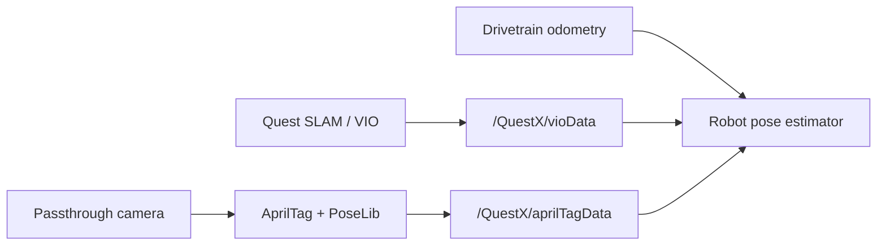

# AprilTag Tracking

QuestX publishes two independent localization inputs to the robot:

- high-rate VIO poses in the Quest's local tracking frame;
- field-relative AprilTag camera-pose measurements with quality and uncertainty metadata.

The Quest does not fuse those inputs. Robot code owns alignment, rejection, and fusion with drivetrain odometry in one estimator.

## Architecture

This avoids cascading two filters with different state, latency, and confidence assumptions. It also lets robot logs show exactly which source produced a bad update.

## Published measurements

Every VIO message includes:

- a local-frame `Pose3d`;
- tracking validity and tracking epoch;
- sequence, NetworkTables capture, and app timestamps.

Every AprilTag message includes:

- a field-relative camera `Pose3d`;
- contributing tag IDs and tag count;
- accepted and candidate corner counts plus inlier ratio;
- average tag distance;
- per-axis standard deviations and, on `/QuestX/v4/apriltag`, the full pose covariance and component-wise projected planar covariance;
- sequence and capture timestamps.

No point clouds or raw SLAM camera inputs are sent over NetworkTables. The computationally heavy SLAM pipeline remains on the Quest.

## Tracking epochs

An Oculus recenter changes the local VIO coordinate frame. QuestX increments `trackingEpoch` when this happens. Robot code must not calculate deltas across an epoch boundary; it should establish a new local-to-field alignment.

## Remote diagnosis

The web status page exposes VIO and AprilTag publish counts, latest tag IDs, inlier quality, measurement age, suggested uncertainty, capture failures, stream clients, and last-frame age. These distinguish tracking loss, detector rejection, camera failure, and transport loss without removing the headset from the robot.

See [Coordinate Systems](./coordinate-systems), [Detection Pipeline](./detection-pipeline), and [Robot-Side Fusion](./kalman-filter) for implementation details.
