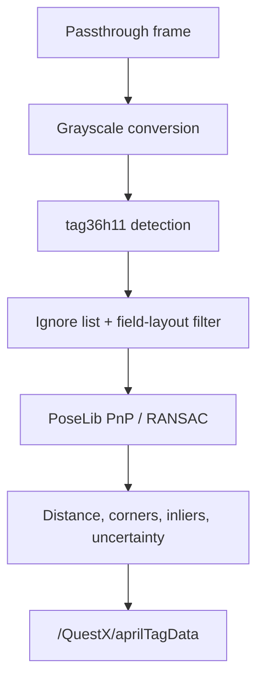

# Detection Pipeline

## Capture and detection

The coroutine samples both NetworkTables time and app uptime beside camera capture. Each frame goes to the configured tag detector (`ITagDetector`), which converts the readback to a reusable grayscale buffer and returns managed `TagDetection`s. Unknown IDs and user-ignored IDs are removed before solving.

Two backends are available, selected by **Tag Detector** on the AprilTag page (API: `aprilTagDetectorMode.detector`, 0 = Napa, 1 = AprilTag). A change takes effect on the next frame:

- **Napa** (default) is a sparse-sampling tag36h11 detector (`native/napa`). It samples one pixel every 3/4 of the smallest cell, skips flat tiles, and fits sub-pixel edges at full resolution. It guarantees tags of at least 24 px (`NAPA_MIN_TAG_PIXELS`) and corrects up to 3 payload bits.
- **AprilTag** is the University of Michigan libapriltag detector (quad decimation 2, 2 corrected bits).

Napa's results are converted to libapriltag's corner order and pixel convention, so PoseLib, the overlay and the observation metrics see identical inputs from either backend. If `libnapa` cannot be loaded, QuestX logs an error and falls back to libapriltag. The status page reports the running backend and its grayscale-plus-detect time (`aprilTag.detector`, `lastDetectMs`, `averageDetectMs`).

The configured minimum-tag and maximum-distance limits are detector-level validity checks. Estimator acceptance rules belong on the robot.

## Pose solving

PoseLib combines the detected 2D corners with their known 3D field locations. It returns the field-relative camera pose, accepted corner count, and candidate corner count. QuestX calculates:

- `inlierRatio = acceptedCorners / candidateCorners`;
- average camera-to-observed-tag distance;
- a suggested uncertainty that grows with distance and shrinks with tag count.

These values are published with the solved pose. A plausible solve in the Quest log no longer implies that a robot estimator accepted it.

## Failure and recovery

Transient camera exceptions no longer terminate the detector. QuestX records the reason, waits, and periodically reapplies the camera arbiter's winning resolution. The passthrough stream uses the same recovery model and preserves the AprilTag detector's higher-priority camera reservation.

The status API reports camera frames, failures, solve count, measurement count, latest outcome, and measurement age for remote diagnosis.
