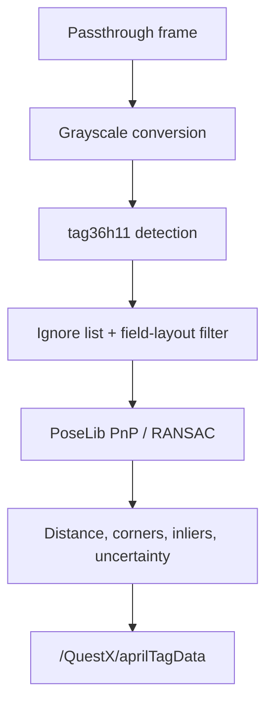

# Detection Pipeline

## Capture and detection

The coroutine samples both NetworkTables time and app uptime beside camera capture. Frames are converted to a reusable grayscale image and passed to the native AprilTag detector. Unknown IDs and user-ignored IDs are removed before solving.

The configured minimum-tag and maximum-distance limits are detector-level validity checks. Estimator acceptance rules belong on the robot.

## Pose solving

PoseLib combines the detected 2D corners with their known 3D field locations. It returns the field-relative camera pose, accepted corner count, and candidate corner count. QuestX calculates:

- `inlierRatio = acceptedCorners / candidateCorners`;
- average camera-to-observed-tag distance;
- a suggested uncertainty that grows with distance and shrinks with tag count.

These values are published with the solved pose. A plausible solve in the Quest log no longer implies that a robot estimator accepted it.

## Failure and recovery

Transient camera exceptions no longer terminate the detector. QuestX records the reason, waits, and periodically reapplies the camera arbiter's winning resolution. The passthrough stream uses the same recovery model and preserves the AprilTag detector's higher-priority camera reservation.

The status API reports camera frames, failures, solve count, measurement count, latest outcome, and measurement age for remote diagnosis.
