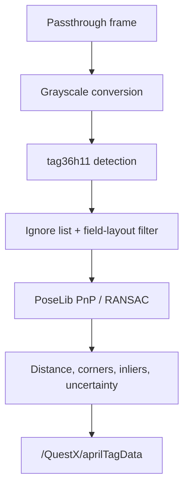

# Detection Pipeline

## Capture and detection

Detection runs off the Unity main thread, so the render loop no longer waits for detection or the GPU readback. The worker still shares CPU and memory bandwidth with rendering. For each new camera image that is due at the configured detection rate, a main-thread coroutine samples NetworkTables time and app uptime against the exposure time, snapshots the camera intrinsics and settings, and starts a non-blocking GPU readback of the camera texture. Meta's `PassthroughCameraAccess.GetColors()` performs the same copy but waits for the GPU, which stalled every frame. When the copy arrives, a dedicated detection thread runs the rest of the pipeline. Up to three frames are in flight: one being read back, one waiting, and one being processed. A newer frame replaces a waiting one, and frames that arrive while all three are busy are dropped.

On that thread, each frame goes to the configured tag detector (`ITagDetector`), which converts the readback to a reusable grayscale buffer and returns managed `TagDetection`s. Unknown IDs and user-ignored IDs are removed before solving. The finished measurement goes back to the main thread for publishing before the worker builds optional 3D-view poses or encodes the preview JPEG. Those views still use the same detections and image, including tags rejected from the field solve. Preview encoding runs at the configured stream rate while a viewer has polled within the last three seconds, allowing capture to overlap browser transfer and decoding. Only the latest complete frame is retained; slow viewers skip intermediate frames. The preview and regular camera stream keep their scheduling phase across camera frames, so a 24 FPS setting on a 30 Hz input is not reduced to every other frame (15 FPS). Normal measurement logs are sampled at most once per second; enabling debug logging restores per-measurement logs. Diagnostics and robot publication continue to update for every measurement.

Two backends are available, selected by **Tag Detector** on the AprilTag page (API: `aprilTagDetectorMode.detector`, 0 = Napa, 1 = AprilTag). A change takes effect on the next frame:

- **Napa** (default) is a sparse-sampling tag36h11 detector from the pinned `napa-vision==0.4.1` PyPI dependency (see `native/napa`). It samples one pixel every 3/4 of the smallest cell, skips flat tiles, and fits sub-pixel edges at full resolution. It guarantees tags of at least 24 px (`NAPA_MIN_TAG_PIXELS`) and corrects up to 3 payload bits, the third only when the wrong cells touch.
- **AprilTag** is the University of Michigan libapriltag detector (quad decimation 2, 2 corrected bits). It splits each frame across up to four threads (half the CPU cores).

Napa's results are converted to libapriltag's corner order and pixel convention, so PoseLib, the overlay and the observation metrics see identical inputs from either backend. The AprilTag preview encodes the grayscale image the running backend actually read (`ITagDetector.Image`); both backends produce identical pixels. If `libnapa` cannot be loaded, QuestX logs an error and falls back to libapriltag. The status page reports the running backend and its grayscale-plus-detect time (`aprilTag.detector`, `lastDetectMs`, `averageDetectMs`). It also reports the other stage times as moving averages: readback, solve, preview encode, and exposure-to-publish latency (`averageReadbackMs`, `averageSolveMs`, `averagePreviewMs`, `averageLatencyMs`). Alongside them are the camera, detection and publish rates (`cameraFps`, `processedFps`, `measurementFps`) and the number of frames dropped while detection was busy (`busyFrameCount`).

The configured minimum-tag and maximum-distance limits are detector-level validity checks. Estimator acceptance rules belong on the robot.

## Pose solving

PoseLib combines the detected 2D corners with their known 3D field locations. It returns the field-relative camera pose, accepted corner count, and candidate corner count. QuestX calculates:

- `inlierRatio = acceptedCorners / candidateCorners`;
- average camera-to-observed-tag distance;
- a suggested uncertainty that grows with distance and shrinks with tag count.

These values are published with the solved pose. A plausible solve in the Quest log no longer implies that a robot estimator accepted it.

## Failure and recovery

Transient camera exceptions no longer terminate the detector. QuestX records the reason, waits, and periodically reapplies the camera arbiter's winning resolution. The passthrough stream uses the same recovery model and preserves the AprilTag detector's higher-priority camera reservation.

The status API reports camera frames, failures, solve count, measurement count, latest outcome, and measurement age for remote diagnosis.
