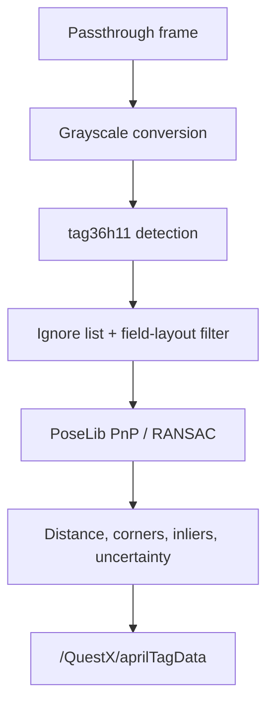

# Detection Pipeline

## Capture and detection

Detection runs off the Unity main thread, so the render loop never waits for the camera or the detector. Frames come from one of two sources; the status page reports which (`aprilTag.captureBackend`).

**Native capture** (default). QuestX opens the left passthrough camera itself through the Android NDK Camera2 API (`native/questx-camera`, `libquestxcamera.so`) and requests 8-bit YUV frames with auto exposure locked to the detection rate (15, 30 or 60 FPS), so dim light lengthens exposure instead of lowering the frame rate. The camera's luma plane is the grayscale image the detectors read, so there is no GPU copy or color conversion. A dedicated capture thread waits on the camera and detects, solves and publishes each frame the moment it arrives, without waiting for a Unity frame. If a frame arrives while the previous one is still being processed, only the newest is kept (`busyFrameCount`). Exposure times come from the camera's sensor timestamps; `averageDeliveryMs` is the time from exposure to the frame reaching the capture thread. Intrinsics and the lens pose come from the camera's calibration (the same values Meta's API reports). Meta's camera access moves to the right camera while QuestX holds the left one, since Android gives each camera to one client at a time.

**Meta's camera access** (fallback). If the native camera cannot start (for example in the Editor, or if Meta's access does not release the left camera within five seconds), QuestX logs why and uses Meta's `PassthroughCameraAccess` until the app restarts. To compare the two on a headset, write `native` or `mruk` to `capture-backend.txt` in the app's files directory (`/sdcard/Android/data/<package>/files/`); the detector restarts on the selected source within a second.

With Meta's camera access the worker still shares CPU and memory bandwidth with rendering. For each new camera image that is due at the configured detection rate, a main-thread coroutine samples NetworkTables time and app uptime against the exposure time, snapshots the camera intrinsics and settings, and starts a non-blocking GPU readback of the camera texture. Meta's `PassthroughCameraAccess.GetColors()` performs the same copy but waits for the GPU, which stalled every frame. When the copy arrives, a dedicated detection thread runs the rest of the pipeline. Up to three frames are in flight: one being read back, one waiting, and one being processed. A newer frame replaces a waiting one, and frames that arrive while all three are busy are dropped.

On the capture or detection thread, each frame goes to the configured tag detector (`ITagDetector`), which reads the native luma directly or converts the readback to a reusable grayscale buffer, and returns managed `TagDetection`s. Unknown IDs and user-ignored IDs are removed before solving. The finished measurement is published to NetworkTables from that thread straight away; field alignment and the 3D scene are updated on the main thread afterwards. Then the thread builds optional 3D-view poses and hands the preview image to its own encoder thread, which copies it, scales it down, and encodes the JPEG at low priority, so preview work never delays the next frame. Those views still use the same detections and image, including tags rejected from the field solve. Preview encoding runs at the configured stream rate while a viewer has polled within the last three seconds, allowing capture to overlap browser transfer and decoding.

The preview is a fraction of the detector resolution per side, set by **Preview resolution** on the stream settings (API: `previewScale`, 1, 2, 4 or 8; default 4, a quarter). At a 1280x960 detector these are 1280x960, 640x480, 320x240 and 160x120. Sizes above 640x480 need the high-quality stream, to protect the robot radio's bandwidth. Detection always uses the full resolution; the tag outlines are scaled with the image. Only the latest complete frame is retained; slow viewers skip intermediate frames. The preview and regular camera stream keep their scheduling phase across camera frames, so a 24 FPS setting on a 30 Hz input is not reduced to every other frame (15 FPS). Normal measurement logs are sampled at most once per second; enabling debug logging restores per-measurement logs. Diagnostics and robot publication continue to update for every measurement.

Two backends are available, selected by **Tag Detector** on the AprilTag page (API: `aprilTagDetectorMode.detector`, 0 = Napa, 1 = AprilTag). A change takes effect on the next frame:

- **Napa** (default) is a sparse-sampling tag36h11 detector from the pinned `napa-vision==0.4.1` PyPI dependency (see `native/napa`). It samples one pixel every 3/4 of the smallest cell, skips flat tiles, and fits sub-pixel edges at full resolution. It guarantees tags of at least 24 px (`NAPA_MIN_TAG_PIXELS`) and corrects up to 3 payload bits, the third only when the wrong cells touch.
- **AprilTag** is the University of Michigan libapriltag detector (quad decimation 2, 2 corrected bits). It splits each frame across up to four threads (half the CPU cores).

Napa's results are converted to libapriltag's corner order and pixel convention, so PoseLib, the overlay and the observation metrics see identical inputs from either backend. The AprilTag preview encodes the grayscale image the running backend actually read (`ITagDetector.Image`); both backends produce identical pixels. If `libnapa` cannot be loaded, QuestX logs an error and falls back to libapriltag. The status page reports the running backend and its grayscale-plus-detect time (`aprilTag.detector`, `lastDetectMs`, `averageDetectMs`). It also reports the other stage times as moving averages: readback (Meta's access) or camera delivery (native), solve, preview scale-and-encode, and exposure-to-publish latency (`averageReadbackMs`, `averageDeliveryMs`, `averageSolveMs`, `averagePreviewMs`, `averageLatencyMs`). Alongside them are the camera, detection and publish rates (`cameraFps`, `processedFps`, `measurementFps`) and the number of frames dropped while detection was busy (`busyFrameCount`).

The configured minimum-tag and maximum-distance limits are detector-level validity checks. Estimator acceptance rules belong on the robot.

## Pose solving

PoseLib combines the detected 2D corners with their known 3D field locations. It returns the field-relative camera pose, accepted corner count, and candidate corner count. QuestX calculates:

- `inlierRatio = acceptedCorners / candidateCorners`;
- average camera-to-observed-tag distance;
- a suggested uncertainty that grows with distance and shrinks with tag count.

These values are published with the solved pose. A plausible solve in the Quest log no longer implies that a robot estimator accepted it.

## Failure and recovery

Transient camera exceptions no longer terminate the detector. With native capture, QuestX restarts the camera a second after a device error or disconnect; a mode change reopens it in the new mode. With Meta's access, QuestX records the reason, waits, and periodically reapplies the camera arbiter's winning resolution. The passthrough stream uses the same recovery model and preserves the AprilTag detector's higher-priority camera reservation.

The status API reports camera frames, failures, solve count, measurement count, latest outcome, and measurement age for remote diagnosis.
